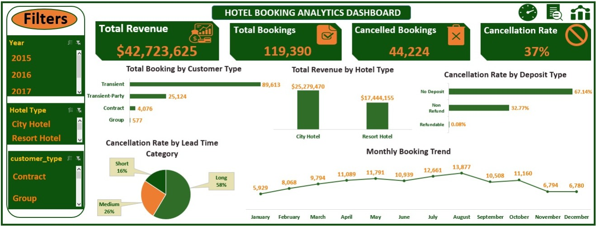
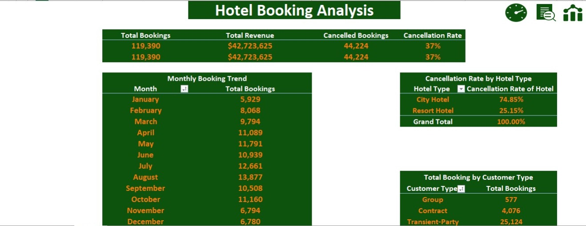
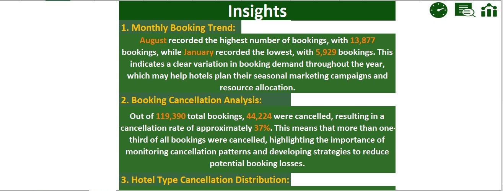

::: {align="center"}
# 🏨 Hotel Booking Data Analysis Project

### An Interactive Hotel Booking Analysis & Dashboard Solution Using Microsoft Excel

**Turning raw hotel booking data into meaningful insights through data
cleaning, transformation, analysis, and visualization.**

[](https://www.microsoft.com/microsoft-365/excel)
[](https://learn.microsoft.com/power-query/)
[](https://support.microsoft.com/excel)
[](https://learn.microsoft.com/dax/)
:::

------------------------------------------------------------------------

## 📌 Project Overview

This project was completed as part of my **Data Analysis Diploma at
Route Academy**. It focuses on analyzing hotel booking data using
Microsoft Excel, with a strong emphasis on data quality, cleaning, and
preparation before analysis.

The project transforms a raw dataset of **119,390 hotel bookings** into
an interactive analytical workbook. It demonstrates an end-to-end
workflow---from inspecting and cleaning the data in Power Query to
creating calculated columns, DAX measures, PivotTables, and an
interactive dashboard.

The final workbook includes a **Dashboard**, an **Analysis** page with
supporting PivotTables, and an **Insights** page summarizing key
findings. Navigation between pages helps users explore the workbook.

## 🎯 Project Objectives

-   Inspect the dataset and understand its structure and data quality.
-   Clean and prepare the data before analysis.
-   Handle missing values and investigate unusual or inconsistent
    values.
-   Check and remove duplicate records where appropriate.
-   Apply text-cleaning techniques such as **Trim** and **Find &
    Replace**.
-   Create calculated columns and DAX measures for booking, revenue, and
    cancellation analysis.
-   Analyze booking trends, cancellation patterns, customer types, and
    estimated revenue.
-   Build an interactive Excel dashboard with KPIs, charts, and slicers.
-   Communicate results through concise, business-focused insights.

## 🧰 Tools & Technologies

  -----------------------------------------------------------------------
  Tool / Technology                   Purpose
  ----------------------------------- -----------------------------------
  **Microsoft Excel**                 Data analysis, reporting, dashboard
                                      design, and workbook navigation

  **Power Query**                     Importing, profiling, cleaning, and
                                      transforming the raw dataset

  **Power Pivot**                     Managing the Excel Data Model and
                                      analytical measures

  **DAX**                             Measures for bookings, estimated
                                      revenue, cancellations, and
                                      cancellation shares

  **Excel Data Model**                Supporting calculations and
                                      PivotTables using prepared data

  **PivotTables**                     Summarizing bookings by month,
                                      customer type, hotel type,
                                      lead-time category, and deposit
                                      type

  **Pivot Charts**                    Visualizing booking trends, revenue
                                      distribution, and cancellation
                                      patterns

  **Slicers**                         Interactive filtering by year,
                                      hotel type, and customer type

  **Excel Charts & Shapes**           Designing KPI cards and presenting
                                      results visually

  **Data Validation**                 Supporting data-quality checks
                                      during preparation

  **Find & Replace**                  Standardizing selected values and
                                      handling categorical data

  **Trim**                            Cleaning unnecessary leading or
                                      trailing spaces in text fields
  -----------------------------------------------------------------------

## 🗂️ Dataset Overview

The project uses `hotel_booking.csv`, containing **119,390 booking
records** across hotel, guest, reservation, arrival, deposit, and
revenue-related fields.

The dataset includes information such as:

-   Hotel type: City Hotel or Resort Hotel
-   Booking status and lead time
-   Arrival year, month, week number, and date
-   Number of adults, children, and babies
-   Customer type and repeated-guest status
-   Deposit type, market segment, and distribution channel
-   Average Daily Rate (ADR) and length of stay
-   Reservation status and status date

The source CSV is stored in the `Data_Source` folder. The prepared data
is used within the Excel workbook for analysis.

## 🧹 Data Cleaning & Preparation

**Data cleaning was a major focus of this project.** Power Query was
used to inspect, clean, transform, and prepare the dataset before
building the analytical outputs.

### Key Data Preparation Steps

-   **Data profiling:** Reviewed column quality, distribution, and
    statistics using the entire dataset rather than only the first 1,000
    rows.
-   **Duplicate handling:** Checked the booking identifier and removed
    duplicate records as part of the preparation workflow.
-   **Missing-value handling:** Reviewed missing values and applied
    replacements where appropriate, including `Unknown` for missing
    country, agent, and company values, and `0` for missing children
    values.
-   **Find & Replace:** Standardized selected categorical and status
    values, including booking status and repeated-guest labels.
-   **Trim and text preparation:** Used text-cleaning techniques to help
    standardize text fields.
-   **Data type correction:** Assigned suitable data types to dates,
    numeric measures, categorical fields, and identifiers.
-   **Date preparation:** Combined arrival year, month, and day into an
    `Arrival_Date` field.
-   **Value investigation:** Reviewed unusual values, including negative
    ADR and extreme baby counts, and applied the project's chosen
    cleaning assumptions.
-   **Calculated columns:** Created additional fields to support
    business analysis.

### Important Calculated Columns

  -----------------------------------------------------------------------
  Column                              Purpose
  ----------------------------------- -----------------------------------
  `Total Stay Nights`                 Calculates total weekend and
                                      weekday nights

  `Guest Type`                        Groups bookings into Single,
                                      Couple, Family, or Unknown based on
                                      guest counts

  `Arrival_Date`                      Combines arrival year, month, and
                                      day into a date field

  `Payment Risk`                      Groups deposit types using the
                                      project's defined classification

  `Total Guests`                      Calculates adults + children +
                                      babies

  `Revenue per Booking`               Estimates revenue using Average
                                      Daily Rate × Total Stay Nights

  `Booking_Status`                    Labels bookings as Cancelled or Not
                                      Cancelled

  `Lead_Time_Category`                Groups lead time into Short,
                                      Medium, and Long categories
  -----------------------------------------------------------------------

**Data interpretation note:** Some cleaning decisions, such as replacing
unusual values, are project assumptions and should be interpreted
accordingly. `Revenue per Booking` is an estimate based on ADR and stay
length, not a verified amount of revenue collected.

## 📐 DAX Measures

  --------------------------------------------------------------------------
  Measure                                Purpose
  -------------------------------------- -----------------------------------
  `Total Bookings`                       Counts distinct booking IDs

  `Total Revenue`                        Sums estimated revenue per booking

  `Cancelled Bookings`                   Counts bookings marked as Cancelled

  `Cancellation Rate`                    Calculates cancelled bookings as a
                                         proportion of total bookings

  `Cancellation Rate of Hotel`           Calculates each hotel type's share
                                         of all cancelled bookings

  `Cancellation Rate of Lead Category`   Calculates each lead-time
                                         category's share of all cancelled
                                         bookings

  `Cancellation Rate of Deposit Type`    Calculates each deposit type's
                                         share of all cancelled bookings
  --------------------------------------------------------------------------

> **Metric clarification:** The three measures ending in Hotel, Lead
> Category, and Deposit Type calculate each category's **share of total
> cancellations**. They do not calculate the cancellation rate within
> each category. The overall `Cancellation Rate` measure calculates
> cancelled bookings divided by total bookings.

## 📊 Dashboard & Analysis

The workbook contains three main analytical pages.

### 1. 🏠 Dashboard

The interactive dashboard provides a high-level overview of hotel
booking performance.

**Key Performance Indicators (KPIs)**

  KPI                          Result
  -------------------- --------------
  Total Bookings              119,390
  Estimated Revenue      \$42,723,625
  Cancelled Bookings           44,224
  Cancellation Rate               37%

**Visualizations included**

-   Total Bookings by Customer Type
-   Estimated Revenue by Hotel Type
-   Share of Cancellations by Deposit Type
-   Share of Cancellations by Lead Time Category
-   Monthly Booking Trend

**Interactive filters**

-   Year
-   Hotel Type
-   Customer Type



### 2. 📑 Analysis

The Analysis page contains the supporting PivotTables used to summarize
and examine the data behind the dashboard.

It includes:

-   Monthly Booking Trend
-   Share of Cancellations by Hotel Type
-   Total Bookings by Customer Type
-   Share of Cancellations by Lead Time Category
-   Estimated Revenue by Hotel Type
-   Share of Cancellations by Deposit Type



### 3. 💡 Insights

The Insights page presents the main findings in a concise format,
connecting results to potential business implications.



## 💡 Key Business Insights

The following findings are based on the project's PivotTables and
dashboard outputs.

### 1. August Recorded the Highest Booking Volume

August had **13,877 bookings**, the highest monthly total, while January
had the lowest, at **5,929 bookings**. This variation may help guide
further investigation into seasonal demand and planning.

### 2. Booking Cancellations Represented Approximately 37% of All Bookings

Out of **119,390 bookings**, **44,224 were cancelled**, resulting in an
overall cancellation rate of approximately **37%**. Cancellation
behavior is therefore an important area for further analysis.

### 3. City Hotels Accounted for the Largest Share of Cancellations

City Hotels represented **74.85%** of all cancelled bookings, while
Resort Hotels represented **25.15%**. These figures show the
distribution of cancellations between hotel types; they do not, by
themselves, indicate which hotel type has the higher cancellation rate
within its own bookings.

### 4. Long Lead-Time Bookings Accounted for the Largest Share of Cancellations

Bookings made more than 90 days before arrival accounted for **58.56%**
of cancellations. Medium lead-time bookings represented **25.74%**, and
short lead-time bookings represented **15.70%**. This suggests that long
lead-time bookings are a useful segment to investigate further.

### 5. Transient Customers Represented the Largest Booking Segment

Transient customers accounted for **89,613 bookings**, approximately
**75.1%** of all bookings. Transient-Party customers were the
second-largest group, with **25,124 bookings**. These figures describe
booking counts, not necessarily unique customer counts.

### 6. City Hotels Generated the Larger Share of Estimated Revenue

City Hotels generated approximately **\$25.28 million** in estimated
revenue, compared with **\$17.44 million** for Resort Hotels. City
Hotels contributed around **59.2%** of total estimated revenue.

> **Revenue note:** Revenue is estimated as
> `Average Daily Rate × Total Stay Nights`. It should not be interpreted
> as confirmed collected revenue, and it may include bookings that were
> later cancelled.

## 📁 Repository Structure

``` text
Final_Project_Hotel_Booking_Data_Analysis_Project/
│
├── Final_Project_Hotel_Booking.xlsx
├── README.md
│
├── Data_Source/
│   └── hotel_booking.csv
│
└── Screenshots/
    ├── Analysis.jpeg
    ├── Dashboard.jpeg
    └── Insights.jpeg
```

## 🚀 How to Use the Project

1.  Download or clone this repository.
2.  Open `Final_Project_Hotel_Booking.xlsx` in Microsoft Excel.
3.  Navigate between the Dashboard, Analysis, and Insights pages.
4.  Use the slicers to filter the dashboard by year, hotel type, and
    customer type.
5.  Review the Analysis page to explore the supporting PivotTables.

> **Note:** Power Query connections and refresh behavior may depend on
> the source-file path. If you move the project to another folder or
> computer, update the source path if Excel requests it before
> refreshing the data.

## 🎓 Skills Demonstrated

-   Data profiling and data quality assessment
-   Data cleaning and transformation using Power Query
-   Missing-value handling and duplicate checks
-   Text standardization using Find & Replace and Trim
-   Data type management and date preparation
-   Calculated columns and DAX measures
-   PivotTable and PivotChart development
-   KPI design and interactive dashboard creation
-   Business analysis and insight communication

## 📧 Contact

**Mohamed Alaa**

Computer Science Graduate \| Aspiring Data Analyst

-   **Email:** mohamedalaawork33@gmail.com
-   **GitHub:**
    [MohamedAlaaWork33](https://github.com/MohamedAlaaWork33)
-   **LinkedIn:** [Mohamed
    Alaa](https://www.linkedin.com/in/mohamed-alaa-1a283a230/)

------------------------------------------------------------------------

::: {align="center"}
**Thank you for checking out my Hotel Booking Data Analysis Project!**
:::
